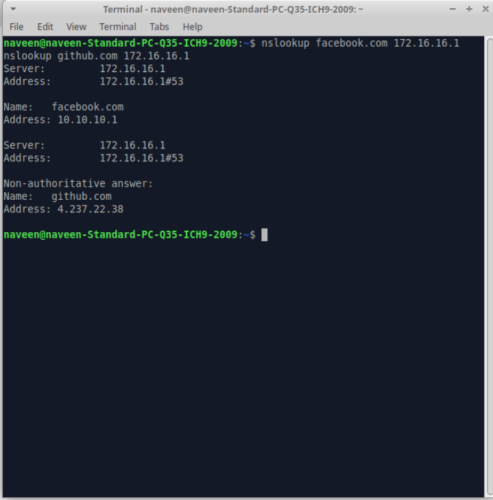
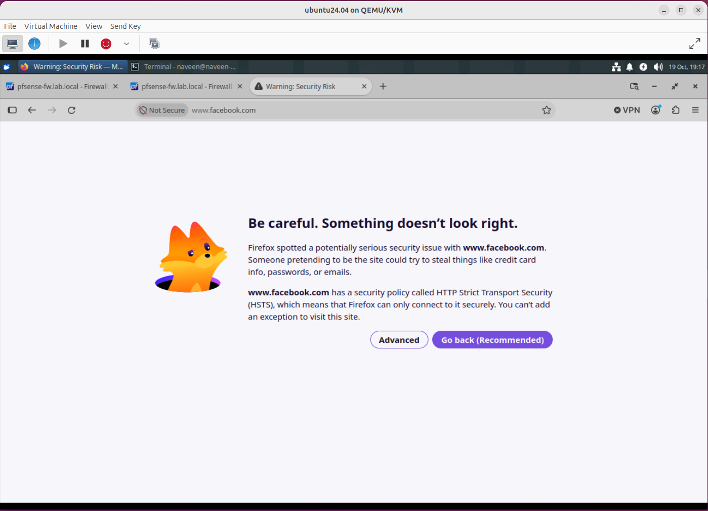
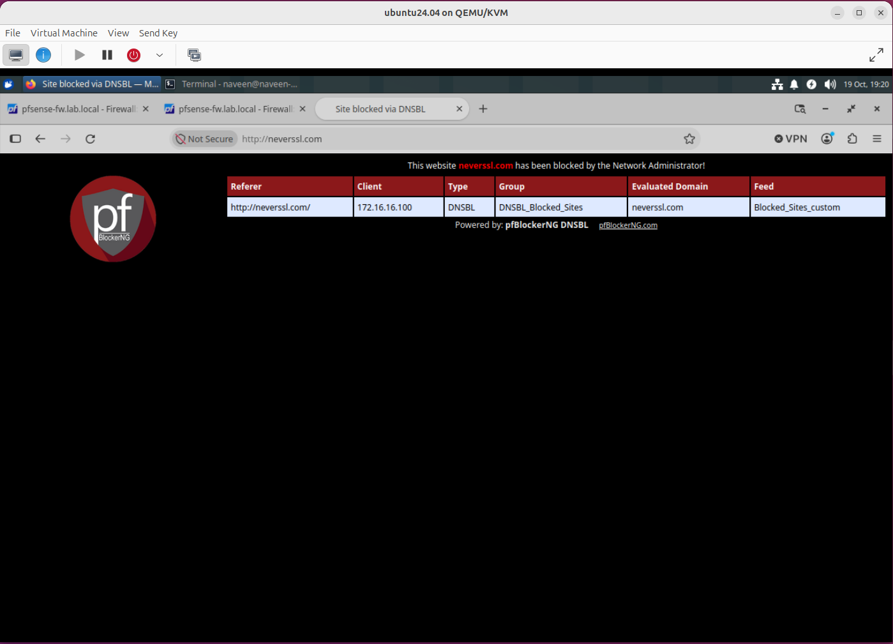
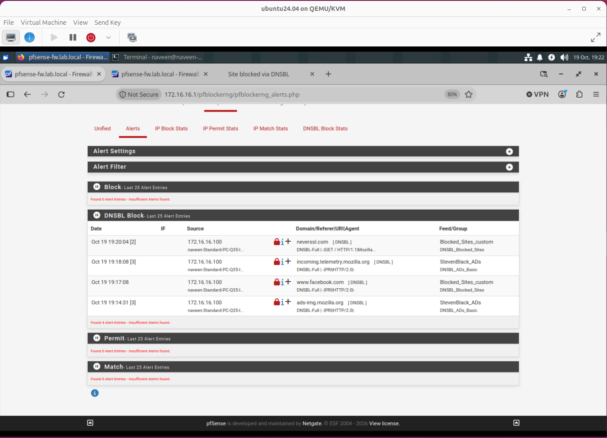
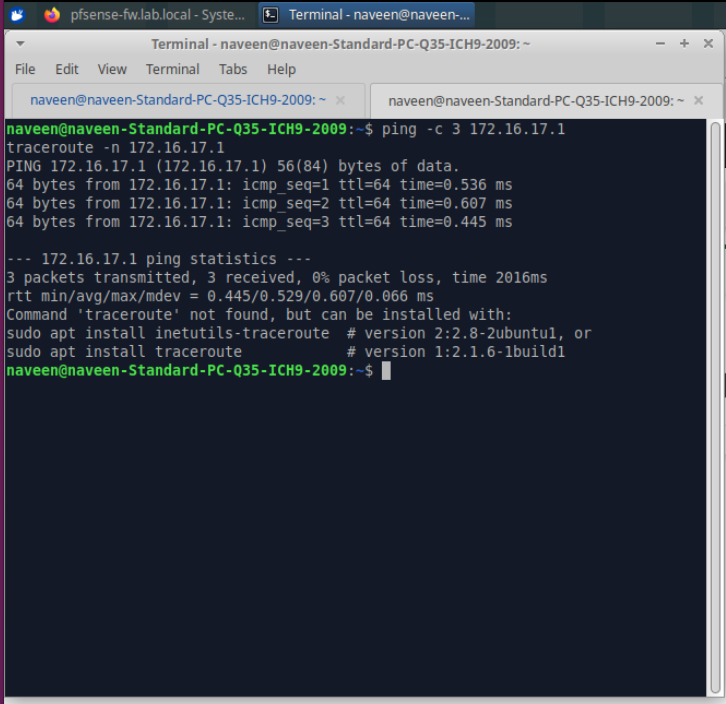
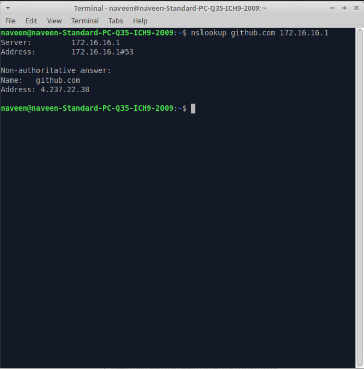
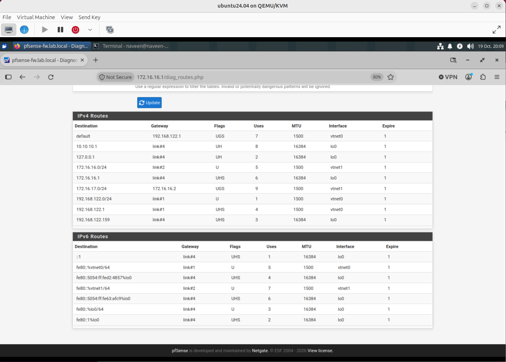

# pfSense Firewall Lab on KVM

A virtual firewall lab built on a single laptop to show how a company network is protected: blocking risky traffic, filtering websites, routing between networks, and logging every blocked attempt.

I originally configured a commercial firewall (Sophos XG) during an IT internship. I rebuilt the same kinds of tasks here with free software (pfSense CE) so the work can be shown and repeated without company equipment.

## What this lab demonstrates

| # | Control | Result |
|---|---|---|
| 1 | Port blocking (SSH and Telnet) | Outbound connections on ports 22 and 23 are dropped and logged. Port 443 still works. |
| 2 | DNS-based web filtering (pfBlockerNG) | Chosen domains resolve to a sinkhole address and show a block page. Other sites are unaffected. |
| 3 | Static routing | pfSense reaches a second subnet (`172.16.17.0/24`) through a separate router VM. |

## Topology

```
                      Internet
                         |
                 libvirt "default" NAT
                   192.168.122.0/24
                         |
                 [ pfSense CE firewall ]
                  WAN: DHCP   LAN: 172.16.16.1/24
                         |
                 libvirt "lab-lan" (isolated)
                   172.16.16.0/24
                    |              |
             [ Client VM ]    [ Router VM ]
             172.16.16.100    172.16.16.2
                              172.16.17.1
                                   |
                         libvirt "lab-lan2" (isolated)
                            172.16.17.0/24
```

| Component | Details |
|---|---|
| Host | Ubuntu on an Acer Aspire laptop, KVM/libvirt, managed with virt-manager and `virsh` |
| Firewall | pfSense CE, WAN on the `default` NAT network, LAN on `lab-lan`, DHCP range 172.16.16.100 to 172.16.16.200 |
| Client | Xubuntu 24.04 VM on `lab-lan`, address from pfSense DHCP |
| Router | Clone of the client VM with two network cards and IP forwarding enabled |
| Web filtering | pfBlockerNG-devel, DNSBL in Unbound mode, sinkhole address 10.10.10.1 |

## 1. Block outbound SSH and Telnet

SSH and Telnet are remote-login protocols that attackers commonly target, so many organisations block them from leaving the network.

**Configuration**

- Alias `Blocked_Ports` (Firewall > Aliases > Ports): 22, 23
- LAN rule: Action Block, Protocol TCP, Source LAN subnets, Destination any, Destination port `Blocked_Ports`, logging on
- The rule sits above the default "allow LAN to any" rule. pfSense reads rules top to bottom and stops at the first match.

**Evidence**


Test from the client VM:

```
nc -zv -w 5 github.com 22     # times out (blocked)
nc -zv -w 5 github.com 443    # succeeds (control test)
```

## 2. DNS-based website blocking

pfBlockerNG answers DNS lookups for blocked domains with a sinkhole address instead of the real one.

**Configuration**

- DNSBL enabled in Unbound mode, virtual IP `10.10.10.1` on the Localhost interface
- Group `Blocked_Sites` with a custom list: `facebook.com`, `www.facebook.com`, `neverssl.com`
- An ad-blocking feed (StevenBlack) is also loaded
- Lists are applied with Update > Force Reload > DNSBL

**Evidence**






```
nslookup facebook.com 172.16.16.1    # 10.10.10.1 (blocked)
nslookup github.com 172.16.16.1      # real address (allowed)
```

## 3. Static route to a second subnet

A second network, `172.16.17.0/24`, sits behind a router VM. pfSense does not own that network, so it needs a static route pointing at the router.

**Configuration**

- Router VM: `172.16.16.2` on `lab-lan`, `172.16.17.1` on `lab-lan2`, `net.ipv4.ip_forward=1`
- pfSense gateway `GW_LAB_ROUTER` = `172.16.16.2` (System > Routing > Gateways)
- Static route `172.16.17.0/24` via `GW_LAB_ROUTER` (System > Routing > Static Routes)

**Evidence**

Before the route, a ping from the client to `172.16.17.1` fails. After the route, it succeeds, and traceroute shows the path through pfSense.






```
traceroute -n 172.16.17.1
 1  172.16.16.1   (pfSense)
 2  172.16.17.1   (router VM)
```

## Problems I hit and how I fixed them

- **Tests that passed for the wrong reason.** My first SSH test ran on the host laptop, which bypasses the firewall. Tests only count when run from the client VM behind pfSense.
- **DNS broke after setup.** The client got `SERVFAIL` from pfSense while `8.8.8.8` worked. Enabling forwarding mode in the DNS Resolver fixed it.
- **WAN is a private network.** "Block private networks" has to stay off on the WAN interface, because the WAN here is itself `192.168.122.0/24`.
- **DNSBL needed a virtual IP first.** The pfBlockerNG wizard failed with "no VIP configured" until I created an IP alias on the Localhost interface.
- **Reload is required.** pfBlockerNG changes only take effect after Force Reload.
- **Cloned VMs.** The router VM was cloned from the client, so I regenerated its machine ID and hostname to avoid duplicate identities.

## Limitations

- DNS filtering blocks whole domains, not URL paths or content categories the way a commercial firewall does. Clients that use their own DNS (for example DNS over HTTPS) can bypass it.
- Sites that enforce HSTS (such as Facebook) cannot show a block page. The browser shows a security warning instead, because the sinkhole cannot present a valid certificate. The request is still blocked.
- The router VM and the client share a network, so return traffic skips pfSense. Ping works, but TCP tests across the route may need pfSense's same-interface bypass setting.
- The client may follow ICMP redirects from pfSense and go straight to the router. I disabled redirects on the client to make the traceroute show the pfSense hop.

## Possible next steps

- OSPF between pfSense and the router VM (FRR)
- DMZ with a published web server
- Remote-access VPN
- Use the pfSense API with Python to export and audit rules, tying into my `net-config-guard` project
